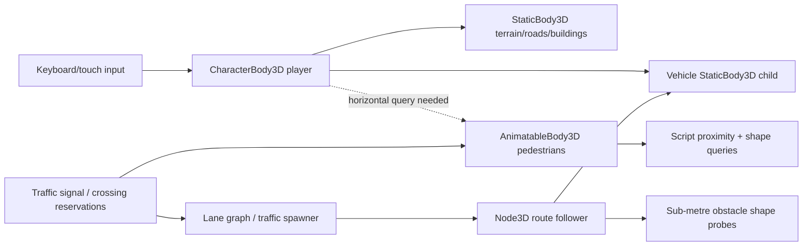

# Civic Chaos — Physics Audit and Baseline
Date: 2026-11-06 | branch: fix/regression-nov05 | inspected head: `75df6ee`
Evidence classification: **source-confirmed**, **reported gameplay**, **runtime-unverified**.

## Scope and architecture
Reviewed the real scene tree, player controller, pedestrian agent generator, lane graph, vehicle agent and spawner, neighborhood collision generation, existing audit documents, and relevant executable tests. Godot 4.7.2 is **not installed in this execution environment**; no import, physics playtest or Android run has been performed here. Existing regression reports must not be treated as verification of this head.

## Source-verified collision inventory
| Body | Shape and position | Layer bit | Mask bit | Evidence |
|---|---|---:|---:|---|
| Player CharacterBody3D | Capsule radius 0.35, height 1.8, collider y=0.9 | 2 | 1 (world-only grounding; actor sweep mask 12) | `scenes/player/player_root.tscn` |
| NPC AnimatableBody3D | Capsule radius 0.32, height 1.75, collider y=0.87 | 8 | 15 (world+player+cars+NPCs) | `scripts/npc/district_pedestrians.gd` |
| Vehicle child StaticBody3D | Box 1.6 x 1.2 x 3.0, collider y=0.7 | 4 | 0 (solid only for querying bodies) | `scenes/traffic/vehicle_agent.tscn` |
| Terrain, roads, sidewalks, buildings | Generated StaticBody3D/BoxShape3D | 1 (default) | 1 (default) | `scripts/world/neighborhood.gd:_block` |
| Boundary walls | StaticBody3D/BoxShape3D | 1 (default) | 1 (default) | `scripts/world/neighborhood.gd:_boundary_wall` |
| Furniture | StaticBody3D, shape assertions added previously | 1 | 0 | `scripts/world/street_furniture.gd`, `tests/world_collision_test.gd` |

## Movement and contact gaps
1. **PHYS-001 / P1:** Player-side pedestrian sweep was introduced in `af04f32`. Commit `b442124` extends it to **vehicles and pedestrians (mask 12)**, while the player's solid mask is now **world-only (1)** so actor roofs cannot become floors. A new physics-frame car contact/release/fall test was added. Runtime behavior is **NOT RUN**.
2. **PHYS-002 / P1:** `district_pedestrians.gd` moves `AnimatableBody3D.position` directly and uses O(N²) proximity, a destination intersection test and basic path geometry. When blocked it waits; it does not attempt sidesteps or route recovery. Initial spawn has no general spatial rejection loop.
3. **PHYS-003 / P1:** `vehicle_agent.gd` advances a Node3D along centerlines and samples a child StaticBody shape at approximately 0.4 m intervals. Other cars, player and NPCs are in query mask, but this is not swept continuous physics or a dynamic contact response. `traffic_spawner.gd` bypasses these checks in isolated graph simulation mode; gameplay mode remains enabled.
4. **PHYS-004 / P1:** `traffic_spawner.gd:_spawn_occupied` compares horizontal center distance to existing cars only. It does not test player, pedestrian, props or full oriented car footprints.
5. **PHYS-005 / P2:** `junction_builder.gd:make_city_graph` creates 80 directed segments using the same centerline in opposite directions. This is not a left-driving lane layout; no curved intersection connectors.
6. **PHYS-006 / P2:** Surface heights differ across road arms and sidewalk; source shows terrain and raised roads. Need dynamic grounding/curb tests, not just height assertions.
7. **PHYS-007 / P2:** Commit `9aa948d` changes `game_lifecycle.gd:load_player` to queue a physics-tick restore. The player controller verifies floor support, normals and shape clearance before placement; blocked/out-of-map saves recover to nearby safe spawn candidates. New physics-frame test added. Runtime behavior is **NOT RUN**.
8. **PHYS-008 / P2:** `scripts/npc/pedestrian_navigator.gd` directly sets `global_position` and is a separate waypoint abstraction; verify integration before changing it.
9. **PERF-PHYS-001 / P2:** O(N²) pedestrian candidate checks and car probes scale with traffic count; benchmark before spatial-grid optimization.

## Contact graph
Player–world: physical; player–car and player–NPC: horizontal sweep, not solid floor collision; NPC–NPC: scripted clearance and query; NPC–car: scripted clearance and query; car–car: fixed-step following and sampled shape probe, not dynamic rigid-body response.

## Known baseline caveat
`build/regression-report.json` checked into the repository contains **36 passing test entries** from an earlier run, with successful import and negative-path checks. The more recent `docs/audits/ISSUE_REGISTER.md` describes a later user run with **38/41 passing** and failures in `traffic_spawner_test.gd`, `pedestrian_collision_test.gd` and `surface_player_test.gd`. Source changes followed, but no retest of those latest changes is established. Treat **current full-suite outcome = NOT RUN / UNVERIFIED**.

## Next action
Run new `tests/player_vehicle_contact_test.gd` and `tests/player_safe_restore_test.gd` along with `tests/player_pedestrian_contact_test.gd`, full local regression, then inspect contacts at 30/60/120 FPS. Do not mark any issue completed merely from a static source inspection.

## 2026-11-06: Player + NPC overlap screenshot follow-up
The requirement was clarified by gameplay screenshots: pedestrians should **not hard-collide with each other or the player**, but they must still appear separated. Current code no longer uses NPCs as physical blockers. Their `AnimatableBody3D` keeps layer 8 (traffic sensor) with collision mask 0; the player uses a world-only solid mask plus a **vehicle-only** horizontal query. Geometry-based NPC personal-space, proactive player yielding, and limited local overlap recovery replace rigid-body contact. Cars can still detect pedestrians through layer 8.

Live player now spawns on a sidewalk at `Vector3(5.7, 0.25, -8.0)` rather than at `Vector3(0, 0.1, 0)` in the junction. Pedestrian spawns use clearance checks with an explicit no-slot skip (never force-overlap after exhausting candidates). The pedestrian obstacle probe ignores ground/floor boxes while retaining building, prop, and vehicle obstruction.

Source commits: `404755a`, `27f32d9`, `484caae`, `28b9969`, `224ebcc`. Godot import and visual verification **NOT RUN**; a live screenshot is required before closing the issue.
